##  {background-color="black"}

```{=html}
<!--
Et bevidst tomt, sort slide (pause før start).
UDKAST, bygget over lærerens disposition. Slides til Opgaver/Projektopgave_wifi_position.qmd;
opgaven er den fulde tekst. Hver slide: én idé, højst ca. 8 punkter.
Tjek med _scripts/slide_hoejde.py efter render.
-->
```

# Positionering uden GPS {background-image="images/indendoers_position_mobil.jpg" background-size="cover" background-opacity="0.45"}

```{=html}
<!-- Fotoet: en hånd holder en mobiltelefon med en plantegning af en bygning; en grøn cirkel viser, hvor telefonen er.
     background-opacity gør fotoet svagere, så titlen kan læses. Fjern den for fuld styrke. -->
```

::: {.absolute bottom="0" right="0" style="font-size: 0.45em;"}
Foto: Intel Free Press, [CC BY-SA 2.0](https://creativecommons.org/licenses/by-sa/2.0), via [Wikimedia Commons](https://commons.wikimedia.org/wiki/File:Indoor_location_services_on_mobile_phone_(10928087126).jpg)
:::

## Hvormange, og hvor ?

:::: {.columns}
::: {.column width="60%"}
- GPS kræver frit udsyn til satellitterne
- **Indendørs** er signalet svagt, unøjagtigt eller helt væk
  - i metroen
  - i indkøbscentre
  - på skolen
- Man gerne vide 
  - **hvor** en enhed er, og
  - **hvor mange** der er
:::
::: {.column width="40%"}
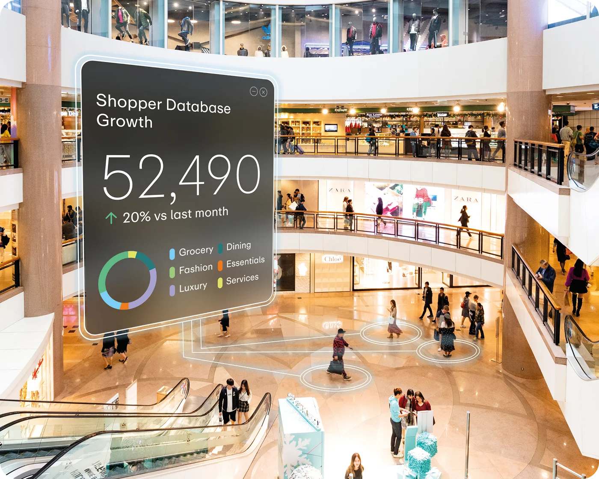{fig-alt="Et indkøbscenter i flere etager set ovenfra med mange mennesker. Over fotoet er lagt en grafik med teksten Shopper Database Growth, 52.490 og 20 % flere end sidste måned, og cirkler på gulvet omkring enkelte personer."}
:::
::::

<!-- ::: billede-mangler
Foto: en metroperron eller et indkøbscenter med mange mennesker (fx Wikimedia Commons, søg "Copenhagen Metro platform")
::: -->

::: notes
Start med et spørgsmål til holdet: hvor har I set det bruges? (butikker, lufthavne, trafiktælling)
:::

## Hvad kan man så bruge?

:::: {.columns}
::: {.column width="66%"}
| Teknologi | Typisk nøjagtighed | Kræver |
|------------------------|------------------------|------------------------|
| UWB ([Ultra-Wideband]{lang="en"}) | ned til ca. 10 cm | særlige UWB-chips og ankre |
| Bluetooth (BLE) | 1–5 m | beacons, eller at enheden sender BLE |
| Wifi | 3–15 m | access points eller lyttere, der fanger pakker |

:::
::: {.column width="34%"}
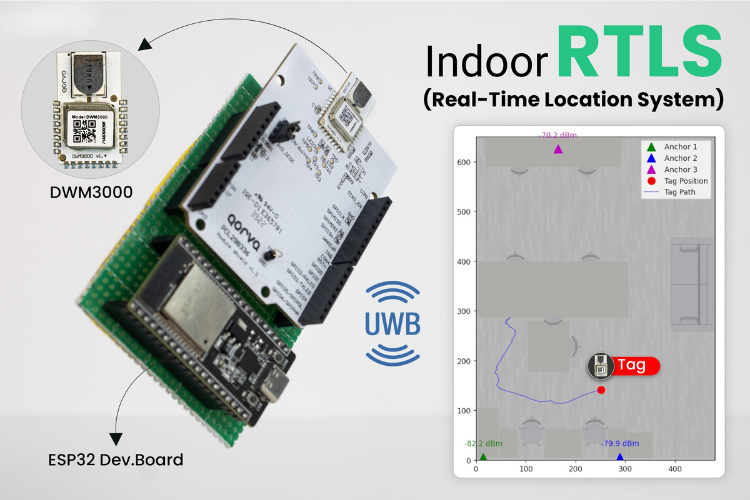{fig-alt="Reklamebillede for et indendørs RTLS (Real-Time Location System) med UWB: et ESP32-udviklingskort med et DWM3000 UWB-modul og ved siden af en plantegning med tre ankre og et tag, hvis rute er tegnet som en linje."}
:::
::::

Vi bruger **wifi**: fordi ESP32 har det indbygget, og næsten alle telefoner har det tændt

::: notes
TJEK: tallene er grove tommelfingerregler; justér efter de kilder, du vil vise.
:::

## Wifi: hvad kan man se?

:::: {.columns}
::: {.column width="58%"}
- Telefoner sender pakker, også når de ikke er forbundet: [*probe requests*]{lang="en"} ("er mit net her?")
- En ESP32 i [*promiscuous mode*]{lang="en"} kan lytte med på pakker, der ikke er til den
- I hver pakke kan man se
  - afsenderens **MAC-adresse**
  - **signalstyrken** (RSSI, i dBm)
  - tidspunkt og kanal
- Nyere telefoner bruger **tilfældige MAC-adresser**, når de leder efter net. Hvad betyder det for os?
:::
::: {.column width="42%"}
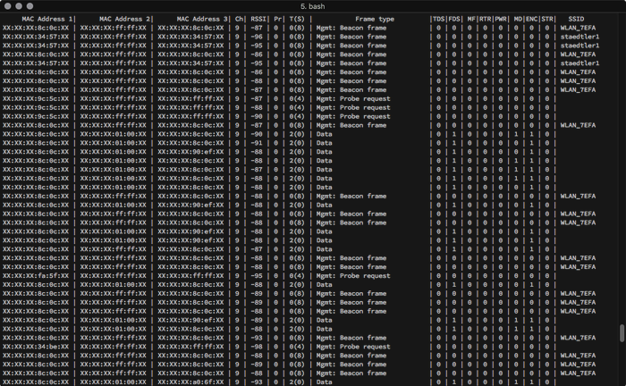{fig-alt="Terminalvindue med output fra en wifi-sniffer: en tabel med kolonnerne MAC-adresse 1 til 3 (delvist skjult med XX), kanal, RSSI omkring −86 til −95 dBm, rammetype som Beacon frame, Probe request og Data, samt SSID."}
:::
::::

<!-- ::: billede-mangler
Skærmbillede: seriel monitor med sniffer-demoen (MAC, RSSI, kanal). Slør MAC-adresserne.
::: -->

## Opstillingen

::::: columns
::: {.column width="42%"}
- Flere ESP32 placeret i hjørnerne af et område (jeres bord eller lokalet)
- Hver ESP32 lytter efter wifi-pakker og måler signalstyrken (RSSI)
- Signalstyrke → omtrentlig afstand til telefonen
- Afstande fra flere ESP32 → position (x, y)
:::

::: {.column width="58%"}
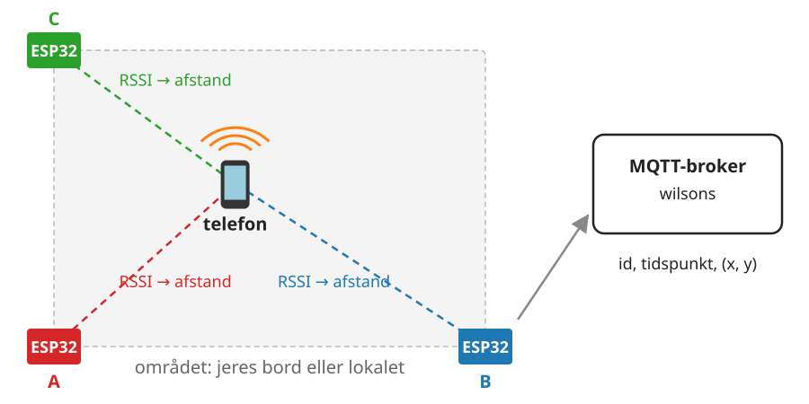{fig-alt="Et område med tre ESP32 i hjørnerne, A og B forneden og C foroven. Fra hver ESP32 går en stiplet linje mod en telefon inde i området, mærket RSSI → afstand. Telefonen sender wifi-signaler. Fra opstillingen går en pil til en MQTT-broker, wilsons, som modtager id, tidspunkt og (x, y)."}
:::
:::::

## Matematikken bag

::::: columns
::: {.column width="55%"}
- **Signalstyrke → afstand**: signalet bliver svagere med afstanden
  - $RSSI = A - 10 \cdot n \cdot \log_{10}(d)$
  - $A$ er RSSI ved 1 m, $n$ afhænger af rummet
- **Afstande → position**: trilateration
  - afstanden fra én lytter giver en cirkel
  - tre lyttere giver tre cirkler, og telefonen er omtrent, hvor de mødes
- RSSI svinger meget (vægge, kroppe, telefonens retning), så positionen er et **skøn**
:::

::: {.column width="45%"}
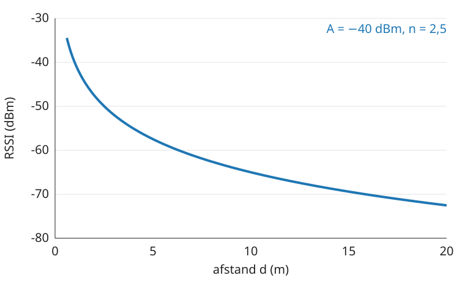{fig-alt="Graf over RSSI i dBm som funktion af afstanden i meter, fra 0 til 20 m. Kurven falder brat de første meter og flader derefter ud: tæt på ændrer signalet sig meget, langt væk kun lidt."}
:::
:::::

## Eksempel: fra RSSI til afstand

::::: columns
::: {.column width="50%"}
Løs formlen for $d$:

$$d = 10^{\frac{A - RSSI}{10 \cdot n}}$$

Med $A = -40$ dBm (målt ved 1 m) og $n = 2{,}5$ (indendørs):

| Målt RSSI | Regnestykke               | Afstand |
|-----------|---------------------------|---------|
| −40 dBm   | $10^{0/25}$               | 1,0 m   |
| −55 dBm   | $10^{15/25} = 10^{0{,}6}$ | 4,0 m   |
| −70 dBm   | $10^{30/25} = 10^{1{,}2}$ | 15,8 m  |
:::

::: {.column width="50%"}
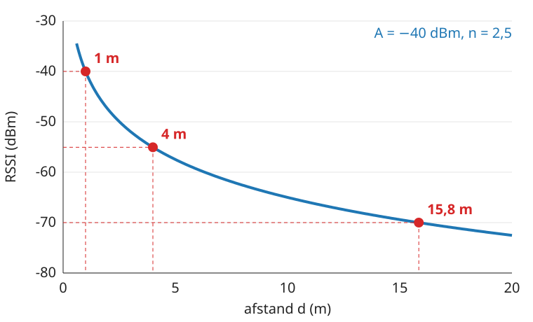{fig-alt="Den samme RSSI-kurve med tre markerede punkter: −40 dBm ved 1 m, −55 dBm ved 4 m og −70 dBm ved 15,8 m."}
:::
:::::

- $A$ og $n$ skal I selv **måle** i jeres lokale: stil telefonen på kendte afstande og aflæs RSSI
- Læg mærke til: 15 dB svagere signal betyder 4 gange så langt væk

## Eksempel: trilateration

::::: columns
::: {.column width="55%"}
Tre ESP32 i et lokale på 4 × 3 m. De har målt afstanden til telefonen:

|     | Placering | Afstand $d$ | $d^2$ |
|-----|-----------|-------------|-------|
| A   | (0, 0)    | 2,24 m      | 5     |
| B   | (4, 0)    | 3,61 m      | 13    |
| C   | (0, 3)    | 1,41 m      | 2     |

Hver afstand giver en cirkel om sin ESP32:

$$
\begin{aligned}
x^2 + y^2 &= 5 \\
(x-4)^2 + y^2 &= 13 \\
x^2 + (y-3)^2 &= 2
\end{aligned}
$$
:::

::: {.column width="45%"}
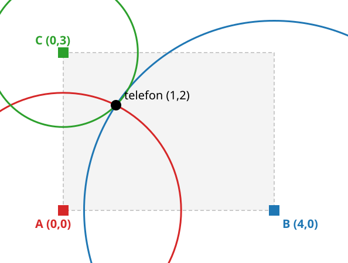{fig-alt="Et rektangulært lokale med tre ESP32: A i (0,0), B i (4,0) og C i (0,3). Om hver ESP32 er tegnet en cirkel med den målte afstand som radius. De tre cirkler skærer hinanden i ét punkt, telefonen i (1,2)."}
:::
:::::

## Eksempel: løs ligningerne

Træk ligning A fra de to andre. Så forsvinder $x^2$ og $y^2$:

$$
\begin{aligned}
(x-4)^2 + y^2 - (x^2 + y^2) &= 13 - 5 &\Rightarrow\quad -8x + 16 &= 8 &\Rightarrow\quad x &= 1 \\
x^2 + (y-3)^2 - (x^2 + y^2) &= 2 - 5 &\Rightarrow\quad -6y + 9 &= -3 &\Rightarrow\quad y &= 2
\end{aligned}
$$

Telefonen står i **(1, 2)**.

::::: columns
::: {.column width="58%"}
- To rette linjer i stedet for tre cirkler: let at regne ud på en ESP32
- **I virkeligheden** mødes cirklerne ikke i ét punkt. Find det punkt, der passer **bedst**: gennemsnit af flere målinger, flere ESP32, mindste kvadraters metode
- **Trilateration** bruger afstande, **triangulering** bruger vinkler. En ESP32 kan kun måle afstande
:::

::: {.column width="42%"}
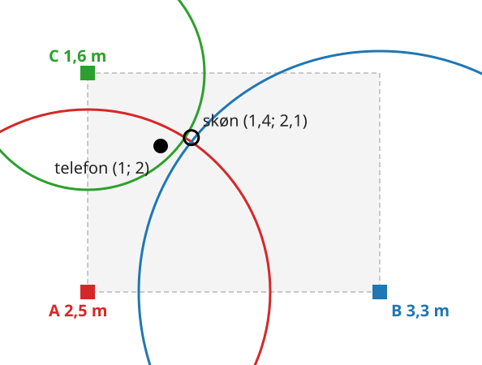{fig-alt="Samme lokale med tre ESP32, men afstandene er målt med fejl: A 2,5 m, B 3,3 m og C 1,6 m. Cirklerne mødes ikke i ét punkt. Det beregnede skøn (1,4; 2,1) ligger lidt fra telefonens rigtige plads (1; 2)." width="380"}
:::
:::::

## Hvem bruger det?

:::: {.columns}
::: {.column width="60%"}
- Indkøbscentre og butikker: hvor mange kommer, hvor går de hen, hvor længe bliver de?
- Lufthavne og stationer: kølængder og trængsel
- Museer, hospitaler og lagre: find vej, find udstyr
- Trafik: rejsetid ud fra de samme enheder set to steder
:::
::: {.column width="40%"}
{fig-alt="Skilt i en lufthavn over gangen mod afgang: Sikkerhedskontrol, forventet ventetid 3-5 min, og det samme via Terminal 3, 470 m."}
:::
::::


<!-- ::: billede-mangler
Foto: en skærm i en lufthavn, der viser ventetiden ved sikkerhedskontrollen
::: -->

<!-- TJEK: find gerne et par konkrete, aktuelle eksempler at vise. -->

# Hvad må man?

{fig-alt="Et skilt med teksten Alarm og videoovervågning på en dørkarm ved indgangen til en butik. Bag glasset ses et overvågningskamera i loftet og en mand ved en disk." height="420"}

## Data om andre mennesker

- Har personerne givet **tilsagn**? 
  - Ved de overhovedet, at de bliver registreret?
- Hvor **følsom** er en MAC-adresse? 
  - Den kan følge en bestemt telefon, og dermed en person
- Hvad sker der, når vi **indsamler**: data bliver gemt, kopieret og kan bruges til andet
- **Berigelse**: MAC + tid + sted siger meget mere end MAC alene
  - hvem kommer her hver tirsdag kl. 8?

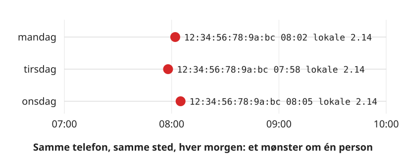{fig-alt="Tidslinje for mandag, tirsdag og onsdag mellem kl. 7 og 10. Hver dag er den samme MAC-adresse set i lokale 2.14 omkring kl. 8. Teksten under siger: samme telefon, samme sted, hver morgen: et mønster om én person." width="760"}

## GDPR

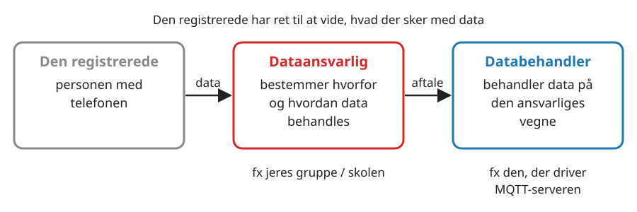{fig-alt="Tre kasser forbundet med pile: den registrerede (personen med telefonen) giver data til den dataansvarlige (bestemmer hvorfor og hvordan data behandles, fx jeres gruppe eller skolen), som har en aftale med databehandleren (behandler data på den ansvarliges vegne, fx den, der driver MQTT-serveren)." width="760"}

- **Dataansvarlig**: den, der bestemmer, hvorfor og hvordan data behandles
- **Databehandler**: den, der behandler data på den ansvarliges vegne
- **Sikkerhed**: hvem kan få adgang, og kan andre lytte med?

#### Sårbarhed

  $sårbarhed = r \cdot s$

  - $r$: risikoen for et brud på datasikkerheden?
  - $s$: skaden for med personerne, hvis data slipper ud?

## Databegrænsning

- Brug kun de data, der er **nødvendige** for formålet
- Gem dem kun, **så længe** det er nødvendigt
- Kan I tælle og placere enheder uden at gemme MAC-adressen?
  - hashe, afkorte, skifte nøgle hver dag, slette efter kort tid
- Jeres valg her er en del af bedømmelsen

::::: columns
::: {.column width="50%"}
Alt sendes:

``` json
{"mac": "12:34:56:78:9a:bc",
 "tid": "2026-11-27T08:02:11",
 "x": 1.03, "y": 2.17}
```
:::

::: {.column width="50%"}
Kun det nødvendige:

``` json
{"id": "7f3a9c",
 "tid": "2026-11-27T08:00",
 "x": 1, "y": 2}
```
:::
:::::

::: notes
Højre: id er en hash af MAC + en nøgle, der skiftes hver dag; tiden er afrundet til kvarter; positionen til hele meter. Persondata er en del af bedømmelsen (se checklisten), ikke et tillæg.
:::

# Opgaven

## Formalia

- Grupper på 2–3, oprettes på itslearning
- I bygger en opstilling med flere ESP32, der lytter efter telefoner
- Resultatet sendes til den lokale MQTT-broker: **id**, **tidspunkt**, **(x, y)**
- Data skal være klar til statistik (fx heatmap), men visualisering er ikke et krav
- Hele opgaven: [Projektopgave, Positionsbestemmelse](../Opgaver/Projektopgave_wifi_position.qmd)

<!-- TJEK: tilføj datoer for start, præsentation og aflevering. Med datoerne kan der laves en tidslinje over forløbet. -->

## En eksplorativ opgave

::::: columns
::: {.column width="52%"}
Der er ikke én rigtig løsning. I skal undersøge:

- **muligheder**: hvad kan lade sig gøre med en ESP32?
- **teknologier**: wifi, BLE, ESP-NOW, ESP-MESH
- **algoritmer** og **metoder**: afstand, trilateration, filtrering af støj
- **alternativer**: hvad gjorde I ikke, og hvorfor?
- **"konkurrenter"**: hvordan løser andre det?
:::

::: {.column width="48%"}
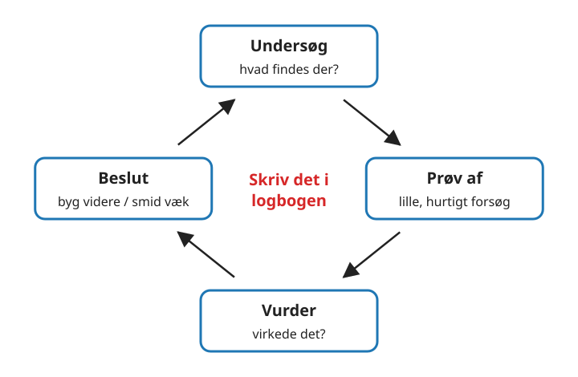{fig-alt="Et kredsløb med fire trin forbundet med pile: undersøg (hvad findes der?), prøv af (lille, hurtigt forsøg), vurder (virkede det?) og beslut (byg videre eller smid væk). I midten står: skriv det i logbogen."}
:::
:::::

## Processen tæller

Processen er vigtig, også i bedømmelsen.

- **Projektstyring**
  - en plan, der bliver justeret undervejs
  - en logbog, som alle skriver i hver dag (i git)
- **Design**
  - algoritmedesign: hvordan bliver målinger til en position?
  - datadesign: hvad sendes, hvad gemmes, hvad smides væk?
  - projektdesign: hvilke dele, og hvem laver hvad?

::: billede-mangler
Skærmbillede: git-log eller commit-graf fra et demo-repo (eller et elevprojekt, med tilladelse)
:::

## Aflevering

::::: columns
::: {.column width="55%"}
- På **itslearning**: zip eller link til jeres repo (læreren skal have adgang)
- Processen fra starten: logbog og arbejdsportfolio
- En **projektbeskrivelse**
- **Programkode**
- **Opsætningsvejledning**: en anden skal kunne få opstillingen til at virke
- **Dataeksempler**: hvad sender opstillingen faktisk?
:::

::: {.column width="45%"}
Fx sådan:

``` text
projekt/
├── README.md       beskrivelse og opsætning
├── logbog.md
├── portfolio/
├── src/            programkode
├── platformio.ini
└── data/           dataeksempler
```
:::
:::::

[Checkliste til bedømmelsen (side og PDF)](../Opgaver/Projektopgave_wifi_position_checkliste.qmd)

::: notes
Målpinde: 5, 9, 13, 14, 22 (fra opgavens front matter).
:::